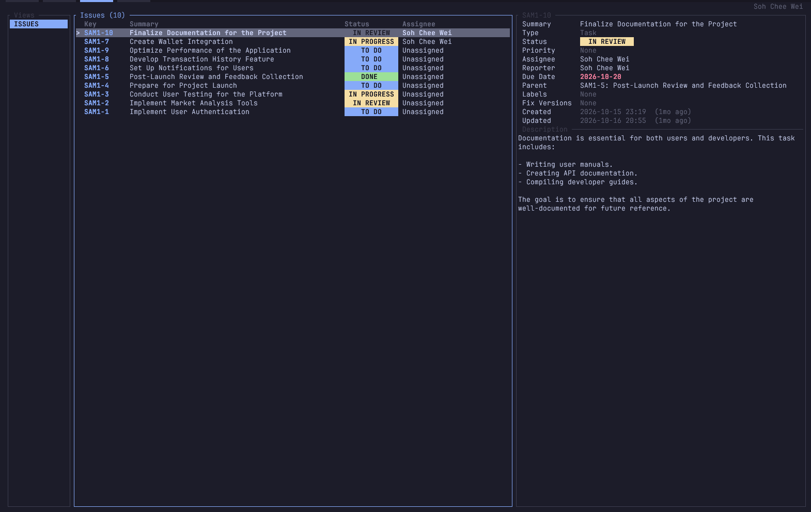

```
██╗  ██╗██╗   ██╗██████╗ ██████╗ ██╗     ███████╗██████╗
██║  ██║██║   ██║██╔══██╗██╔══██╗██║     ██╔════╝██╔══██╗
███████║██║   ██║██████╔╝██║  ██║██║     █████╗  ██████╔╝
██╔══██║██║   ██║██╔══██╗██║  ██║██║     ██╔══╝  ██╔══██╗
██║  ██║╚██████╔╝██║  ██║██████╔╝███████╗███████╗██║  ██║
╚═╝  ╚═╝ ╚═════╝ ╚═╝  ╚═╝╚═════╝ ╚══════╝╚══════╝╚═╝  ╚═╝
```

A fast, keyboard-driven terminal UI for Jira. Browse, search, create, and update issues without leaving your terminal. Inspired by [glab-tui](https://github.com/rcieri/glab-tui)



## Install

### Homebrew

```sh
brew tap cheeweisoh/hurdler
brew install hurdler
```

### Cargo

```sh
cargo install hurdler
```

### From Source

```sh
git clone https://github.com/cheeweisoh/hurdler
cd hurdler
cargo build --release
```

## Getting Started

1. Create a Jira API token in your Atlassian Profile settings.
2. Run `hurdler init` and enter your Jira credentials.
3. Run `hurdler`.

## License

MIT. hurdler is not affiliated with or endorsed by Atlassian.
